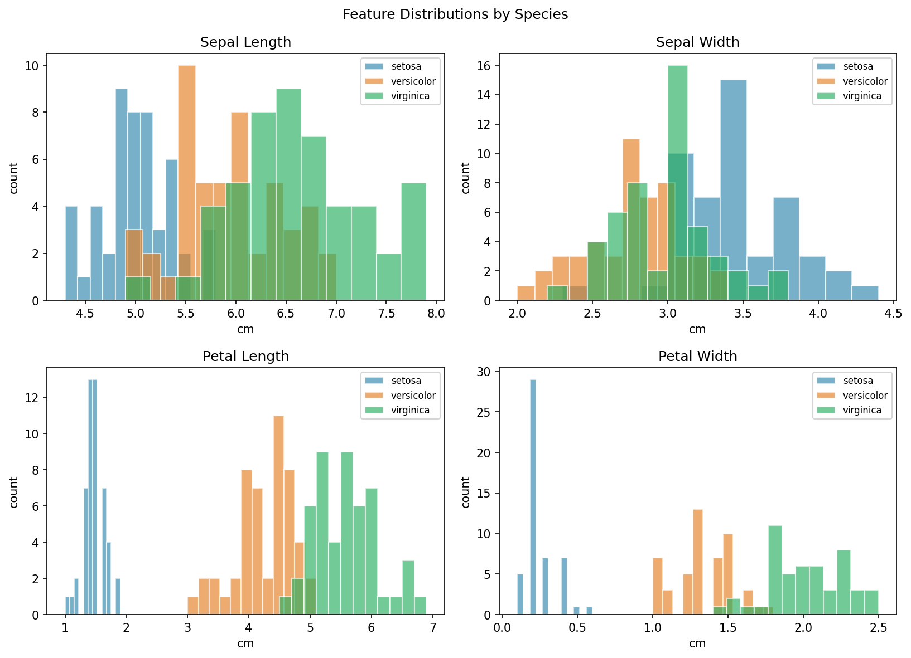
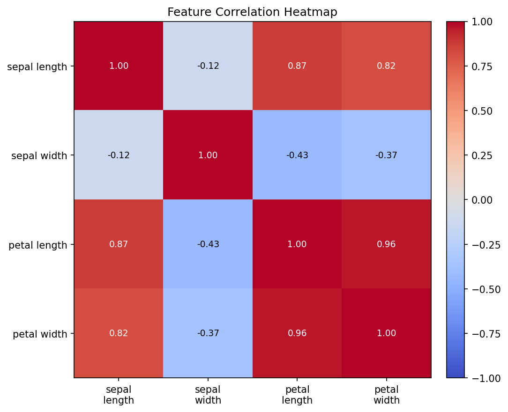
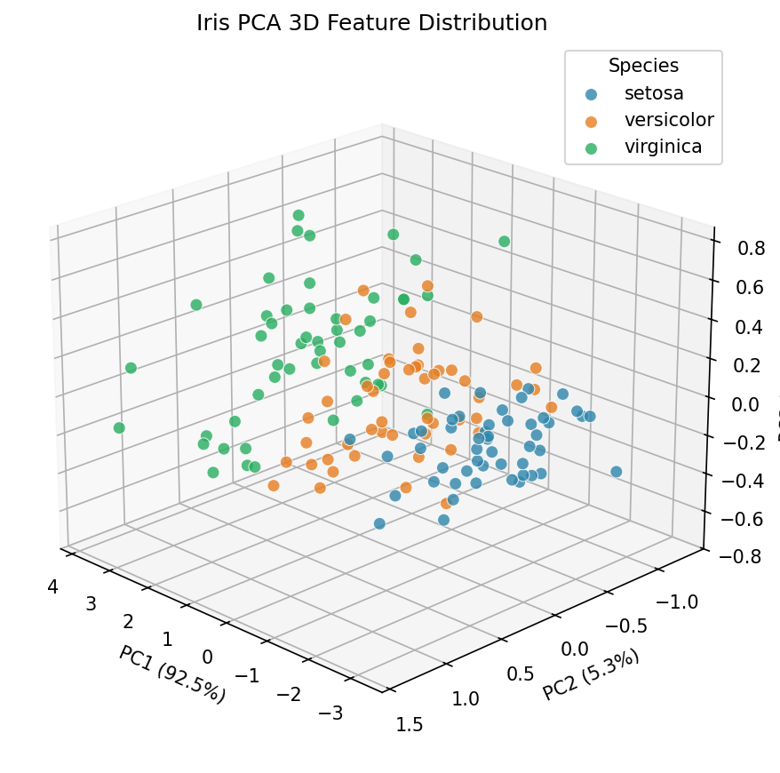
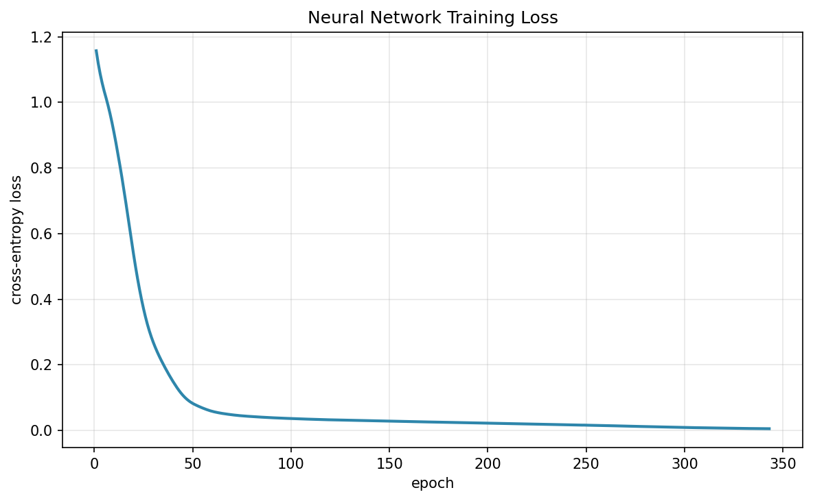
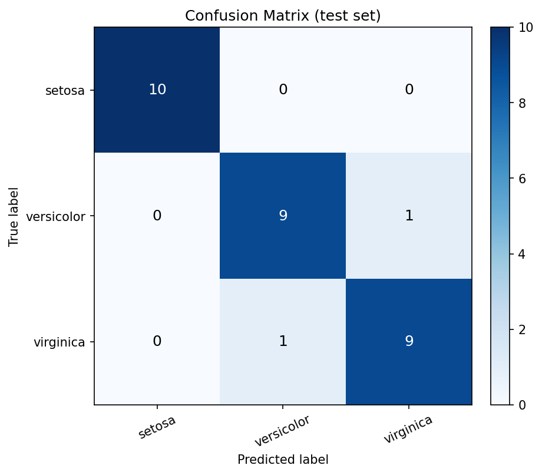
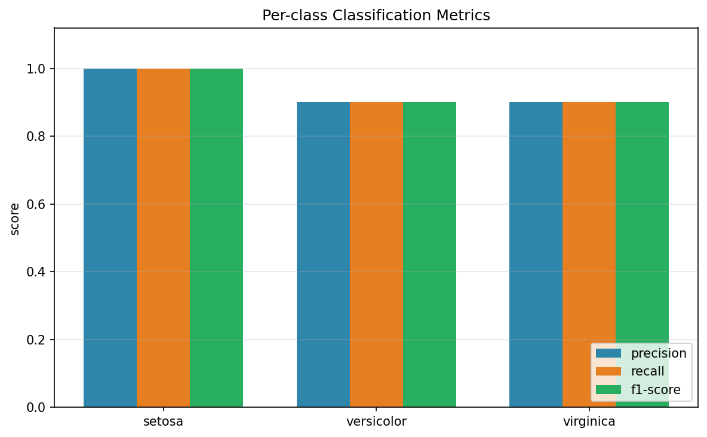

# Iris 資料集分析與類神經網路分類之小論文

## 摘要

本研究以經典的 Iris（鳶尾花）資料集為對象，完成資料取得、保存、探索分析與分類建模。資料共 150 筆樣本、4 個數值特徵與 3 個類別（setosa、versicolor、virginica）。研究先以敘述統計、離群值偵測與相關性分析檢視資料品質，再以主成分分析（PCA）將四維特徵投影至三維空間進行視覺化；其中前三主成分累積解釋變異量達 99.48%。分類模型採用多層感知器（MLP）類神經網路，經標準化與分層切分後訓練，最終於測試集取得 accuracy = 0.9333、macro F1-score = 0.9333 的表現。結果顯示，Iris 在適當的前處理與網路設定下可被高效率地區分，適合作為機器學習教學與方法驗證的基準資料集。

## 1. 研究背景

Iris 資料集由統計學家 R. A. Fisher 於 1936 年整理發表，長年作為分類演算法與統計方法的基準資料。其特徵尺度一致、類別平衡且具備良好的可分性，非常適合用來驗證資料前處理、降維視覺化與類神經網路分類流程。本研究依循完整資料科學流程，從資料取得一路推進到模型評估與結果詮釋，並以測試導向開發（TDD）確保分析程式可重現、可驗證。

## 2. 資料集

### 2.1 來源與授權

- 來源：scikit-learn 內建 `load_iris`（原始資料源自 UCI Machine Learning Repository 的 Iris 資料集）。
- 樣本數：150 筆；特徵數：4；類別數：3。
- 授權：UCI Iris 資料集採 CC BY 4.0；本專案保存的 `data/iris.csv` 為由 scikit-learn 載入後轉存之副本，僅供教學與研究使用。

### 2.2 欄位說明

| 欄位 | 型別 | 說明 | 單位 |
| --- | --- | --- | --- |
| sepal_length | float | 花萼長度 | cm |
| sepal_width | float | 花萼寬度 | cm |
| petal_length | float | 花瓣長度 | cm |
| petal_width | float | 花瓣寬度 | cm |
| species | string | 品種標籤（分類目標） | - |

### 2.3 分類分布

|            |   樣本數 | 占比   |
|:-----------|---------:|:-------|
| setosa     |       50 | 33.3%  |
| versicolor |       50 | 33.3%  |
| virginica  |       50 | 33.3%  |

三類別各 50 筆，屬完全平衡資料集，因此 accuracy 與 macro 平均指標皆具參考價值。

## 3. 資料探索與檢查

### 3.1 基本檢查

| 檢查項目 | 結果 |
| --- | --- |
| 樣本數 | 150 |
| 特徵數 | 4 |
| 類別數 | 3 |
| 缺值總數 | 0 |
| 重複列數 | 1 |
| 離群值列數（IQR 法則） | 4 |

資料沒有缺值；重複列為特徵值完全相同但可能屬於不同品種的觀測，保留以維持原始資料完整性。

### 3.2 描述性統計

| 特徵 | count | mean | std | min | 25% | 50% | 75% | max |
| --- | --- | --- | --- | --- | --- | --- | --- | --- |
| sepal_length | 150.0000 | 5.8433 | 0.8281 | 4.3000 | 5.1000 | 5.8000 | 6.4000 | 7.9000 |
| sepal_width | 150.0000 | 3.0573 | 0.4359 | 2.0000 | 2.8000 | 3.0000 | 3.3000 | 4.4000 |
| petal_length | 150.0000 | 3.7580 | 1.7653 | 1.0000 | 1.6000 | 4.3500 | 5.1000 | 6.9000 |
| petal_width | 150.0000 | 1.1993 | 0.7622 | 0.1000 | 0.3000 | 1.3000 | 1.8000 | 2.5000 |

花瓣長度（petal_length）的平均值與變異程度明顯高於其他特徵，且花瓣相關特徵對品種的區分能力較強。

### 3.3 離群值檢查

以各特徵的 1.5 倍四分位距（IQR）法則偵測，共有 4 筆樣本至少存在一個離群特徵值。由於 Iris 屬自然量測資料，且離群幅度有限，本研究保留這些樣本，避免過度清理造成資訊流失。

| 資料列索引 | outlier_count | is_outlier |
| --- | --- | --- |
| 15 | 1 | True |
| 32 | 1 | True |
| 33 | 1 | True |
| 60 | 1 | True |

### 3.4 特徵分布與相關性

*圖：各特徵依品種的分布*

*圖：特徵相關性熱圖*

花瓣長度與花瓣寬度呈高度正相關，兩者亦與花萼長度有明顯關聯；花萼寬度與其他特徵的相關性較弱。這意味著資料存在可壓縮的共線性結構，適合以 PCA 降維。

### 3.5 PCA 三維特徵分布

PCA 將四個特徵線性組合為互相正交的主成分。前三主成分的解釋變異量比例分別為 92.46%、5.31%、1.71%，累積達 99.48%，因此三維投影足以呈現資料的主要結構。

*圖：Iris 資料 PCA 三維特徵分布（依品種著色）*

圖中 setosa 與其餘兩類明顯分離；versicolor 與 virginica 部分重疊，暗示這兩類的分類邊界較具挑戰性，也解釋了後續模型可能出現的少量混淆。

## 4. 方法

### 4.1 資料切分與前處理

採分層抽樣（stratified split）將資料分為 120 筆訓練集與 30 筆測試集（test_size = 0.2，random_state = 42），確保各類別在兩個子集中比例一致。特徵標準化（StandardScaler）僅以訓練集估計參數，再套用至測試集，以避免資料洩漏。

| 資料集   |   樣本數 |   setosa |   versicolor |   virginica |
|:---------|---------:|---------:|-------------:|------------:|
| 訓練集   |      120 |       40 |           40 |          40 |
| 測試集   |       30 |       10 |           10 |          10 |

### 4.2 主成分分析（PCA）

以 `sklearn.decomposition.PCA` 對四個原始特徵進行降維，保留三個主成分用於視覺化。PCA 僅用於探索與呈現，分類模型仍使用原始四維特徵，以避免降維造成的資訊損失。

### 4.3 類神經網路模型

模型採多層感知器（Multi-layer Perceptron），輸入層 4 個神經元、兩個隱藏層、輸出層 3 個神經元（對應三個品種），以 ReLU 為激活函數、Adam 為優化器，搭配交叉熵損失進行訓練。

| 項目 | 設定 | 值 |
| --- | --- | --- |
| 0 | 隱藏層 | (16, 8) |
| 1 | 激活函數 | relu |
| 2 | 優化器 | adam |
| 3 | 學習率 | 0.010000 |
| 4 | L2 正則化 (alpha) | 0.000100 |
| 5 | 最大迭代次數 | 2000 |
| 6 | 實際迭代次數 | 343 |
| 7 | 隨機種子 | 42 |

### 4.4 評估指標

以測試集計算 Accuracy、macro Precision、macro Recall、macro F1-score 與混淆矩陣。由於類別平衡，macro 平均能公平反映各類別的表現。

## 5. 實驗結果

### 5.1 訓練過程

訓練損失由初始的 1.1575 下降至 0.0050，共迭代 343 次，收斂情形穩定。

*圖：類神經網路訓練損失曲線*

### 5.2 整體分類表現

| 指標              |   數值 |
|:------------------|-------:|
| Accuracy          | 0.9333 |
| Precision (macro) | 0.9333 |
| Recall (macro)    | 0.9333 |
| F1-score (macro)  | 0.9333 |

### 5.3 混淆矩陣

*圖：測試集混淆矩陣*

混淆矩陣顯示 setosa 全數正確分類；錯誤主要發生在 versicolor 與 virginica 之間，與 PCA 三維分布中兩類重疊的觀察一致。

### 5.4 各類別指標

| 類別 | precision | recall | f1-score | support |
| --- | --- | --- | --- | --- |
| setosa | 1.0000 | 1.0000 | 1.0000 | 10.0000 |
| versicolor | 0.9000 | 0.9000 | 0.9000 | 10.0000 |
| virginica | 0.9000 | 0.9000 | 0.9000 | 10.0000 |

*圖：各類別 precision / recall / F1-score*

## 6. 討論

1. **特徵可分性**：花瓣長度與花瓣寬度是最具鑑別力的特徵。PCA 結果顯示前兩個主成分已保留大部分變異，setosa 在低維空間即可被線性分離。
2. **錯誤型態**：versicolor 與 virginica 在特徵空間中相鄰且部分重疊，是主要誤判來源。若需進一步提升表現，可考慮增加隱藏層容量、改用正則化或集成方法。
3. **模型選擇**：MLP 在此小樣本資料上已能達到高準確率，且訓練成本低。惟類神經網路對隨機初始化與超參數較敏感，本研究固定 random_state 以確保結果可重現。
4. **研究限制**：資料量僅 150 筆，測試集僅 30 筆，單次切分的評估變異較大；更嚴謹的做法是採用 k-fold 交叉驗證並報告平均值與標準差。

## 7. 結論

本研究完成 Iris 資料集的取得、保存、探索分析、PCA 三維視覺化、MLP 分類模型訓練與評估，並將結果整理為本小論文。實驗結果顯示，經標準化與分層切分後，類神經網路在測試集可達到 93.33% 的準確率與 0.9333 的 macro F1-score。整體流程以測試導向開發實作，確保每一步驟皆可重現與驗證，可作為後續機器學習實驗的基礎範例。

## 參考文獻

1. Fisher, R. A. (1936). The use of multiple measurements in taxonomic problems. *Annals of Eugenics*, 7(2), 179–188.
2. Pedregosa, F. et al. (2011). Scikit-learn: Machine Learning in Python. *Journal of Machine Learning Research*, 12, 2825–2830.
3. Dua, D. & Graff, C. (2019). UCI Machine Learning Repository. University of California, Irvine.
4. Rumelhart, D. E., Hinton, G. E., & Williams, R. J. (1986). Learning representations by back-propagating errors. *Nature*, 323, 533–536.
